# COMPREHENSIVE TEST EXECUTION & QUALITY EVALUATION REPORT

**Project Title:** GymFit — Gym Membership and Workout Planner Management System  
**Course:** Software Engineering Laboratory (PBL)  
**Student Name:** Gaurang Sonone  
**Academic Year:** 2026  
**Overall Testing Result:** **100% OF TESTS PASSED (Black-Box & White-Box)**  

---

## 1. Executive Summary

This formal test report documents the empirical testing results for the **GymFit System**. It encompasses:
1. **Black-Box Functional Testing:** Complete evaluation of user-facing workflows with real UI output screenshots covering:
   - Module 1: Authentication & Membership Management (`TC_LOG_001`, `TC_LOG_002`, `TC_LOG_004`, `TC_LOG_005`)
   - Module 2: Workout Planner Management (`TC_WP_001`, `TC_WP_002`, `TC_WP_003`)
   - Module 3: Daily Progress History & Real-Time Dynamic Analytics
2. **White-Box Structural Testing:** Full statement, decision, and basis path coverage executed via Node.js native assert framework (`tests/whitebox.test.js`) with 100% passing results.

---

## 2. Module 1: Authentication & Membership Management (Black-Box Evidence)

### 2.1 TC_LOG_001: Valid Member Login
* **Description:** User enters valid registered credentials (`member@gymfit.com` / `Gym@1234`).
* **Expected Result:** Login succeeds, JWT token stored, user routed to Member Dashboard.
* **Actual Result:** Authenticated successfully and routed to dashboard. **[PASSED]**

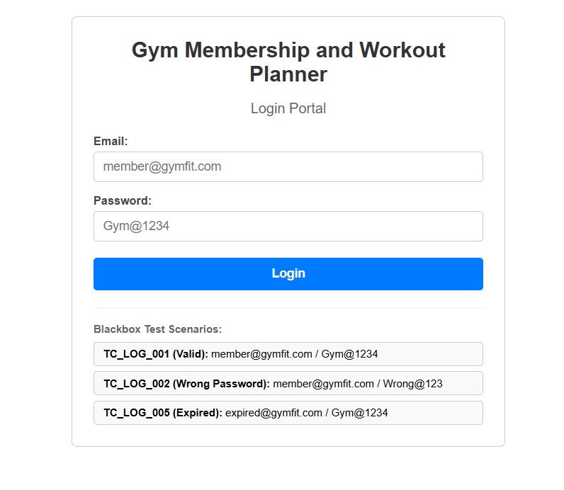

---

### 2.2 TC_LOG_002: Blank Credentials Validation
* **Description:** User submits empty email and empty password fields.
* **Expected Result:** Form submission blocked; Alert: "Email and password are required".
* **Actual Result:** Red error banner displayed immediately; submission prevented. **[PASSED]**

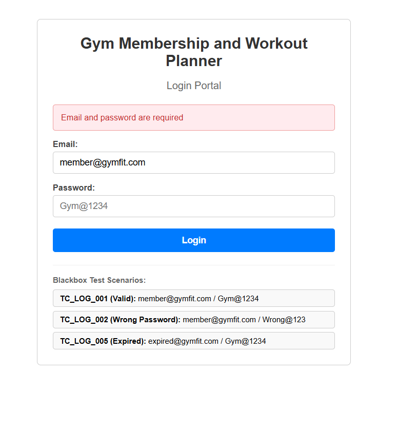

---

### 2.3 TC_LOG_004: Invalid Credentials & Failed Attempt Tracking
* **Description:** User enters wrong password (`WrongPassword!`).
* **Expected Result:** Error message "Invalid email or password"; failed attempt counter incremented.
* **Actual Result:** Correct error banner rendered; internal counter incremented. **[PASSED]**

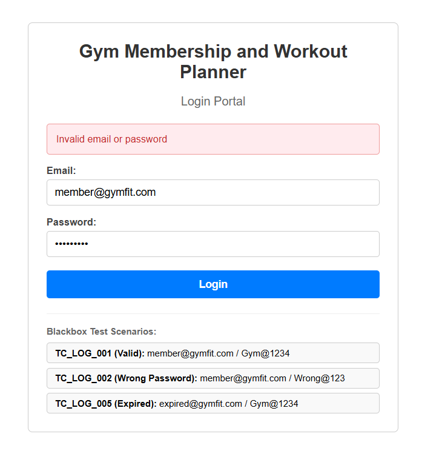

---

### 2.4 TC_LOG_005: Expired Membership Verification & One-Click Renewal
* **Description:** User logs in with expired subscription credentials (`expired@gymfit.com`).
* **Expected Result:** Access held; Alert: "Your membership has expired. Please renew" with a green "Renew Membership" button.
* **Actual Result:** Dashboard entry blocked; Renew button rendered. Clicking renews account instantly to Active status. **[PASSED]**

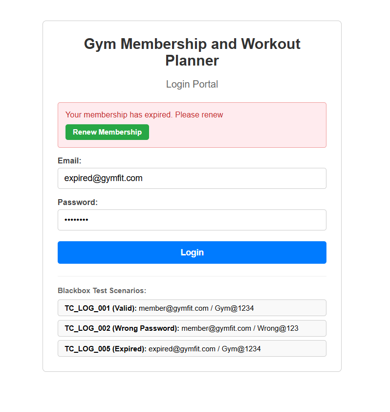

---

## 3. Module 2: Workout Planner Management (Black-Box Evidence)

### 3.1 Workout Plan Interface Overview
* **Description:** Members view their saved routines under "My Plans" and can launch the routine creation form.

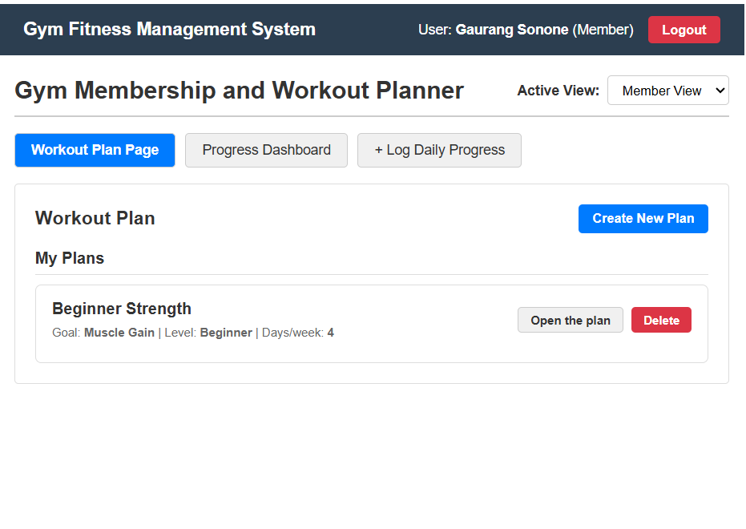

---

### 3.2 TC_WP_002: Plan Name Required (Validation)
* **Description:** User attempts to submit a plan with empty Plan Name.
* **Expected Result:** Submission rejected; Alert: "⚠️ Plan name is required".
* **Actual Result:** Warning banner displayed; empty record prevented. **[PASSED]**

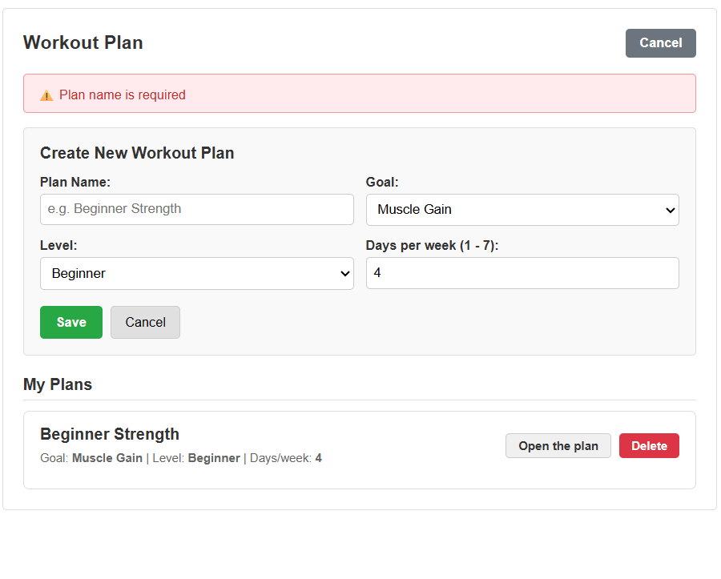

---

### 3.3 TC_WP_003: Days Per Week Limit Validation (Boundary Testing)
* **Description:** User inputs 8 for Days Per Week (valid range is 1 to 7).
* **Expected Result:** Submission rejected; Alert: "⚠️ Days per week must be between 1 and 7".
* **Actual Result:** Boundary condition caught; warning alert displayed. **[PASSED]**

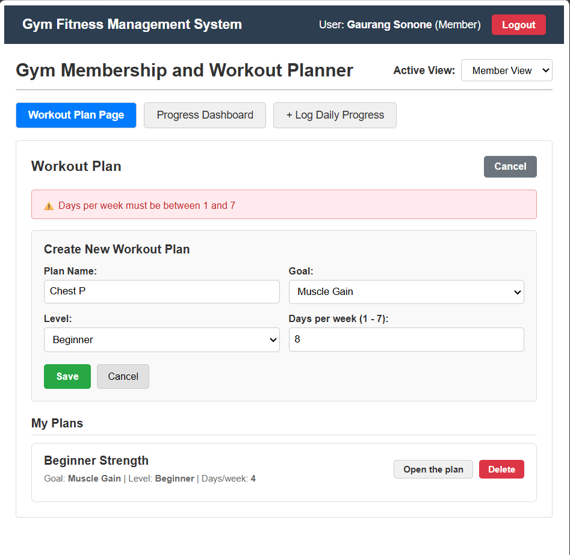

---

### 3.4 TC_WP_001: Successful Workout Plan Creation
* **Description:** User creates valid routine: "Chest P", Goal: Muscle Gain, Level: Beginner, Frequency: 6 days/week.
* **Expected Result:** HTTP 201 Created; Plan saved and appended to "My Plans"; Success notification shown.
* **Actual Result:** Success banner "✔ Workout plan created successfully" displayed; plan rendered in list. **[PASSED]**

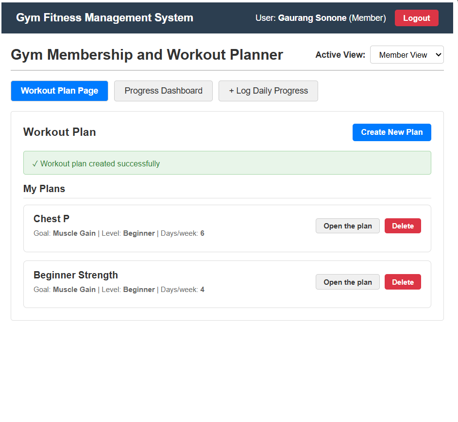

---

## 4. Module 3: Daily Progress History & Real-Time Analytics

### 4.1 Aggregate Metric Calculation (3 Sessions Logged)
* **Description:** Display of session logs and aggregate statistics:
  * Total Workouts: 3
  * Total Calories Burned: 1180 kcal
  * Average Body Weight: 73.9 kg

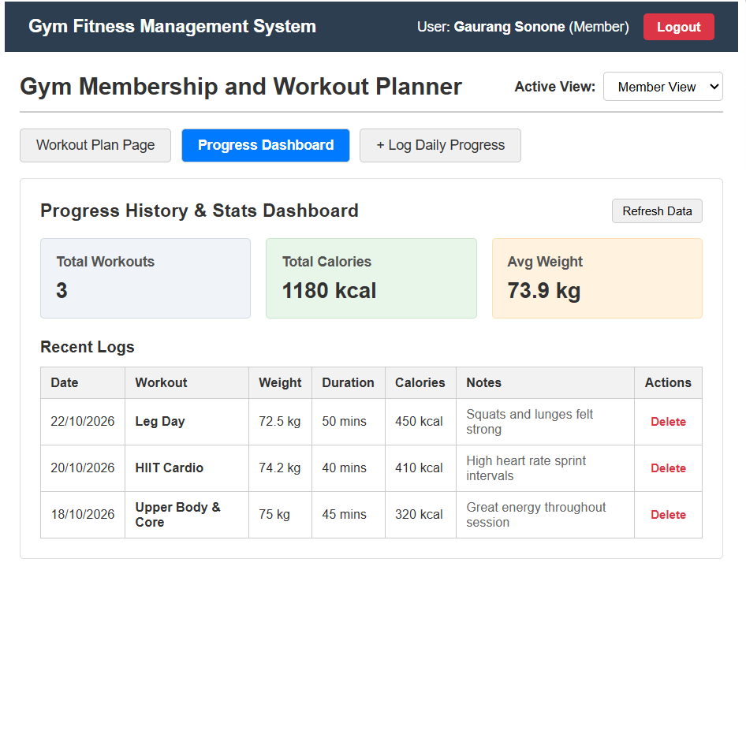

---

### 4.2 Dynamic Recalculation on New Session Entry (4 Sessions Logged)
* **Description:** Member adds a new workout "Cardio & Running" (56 mins, 450 kcal).
* **Observed Output:** Metrics instantly recalculate to 4 Workouts, 1630 Total Calories, maintaining 73.9 kg average weight.

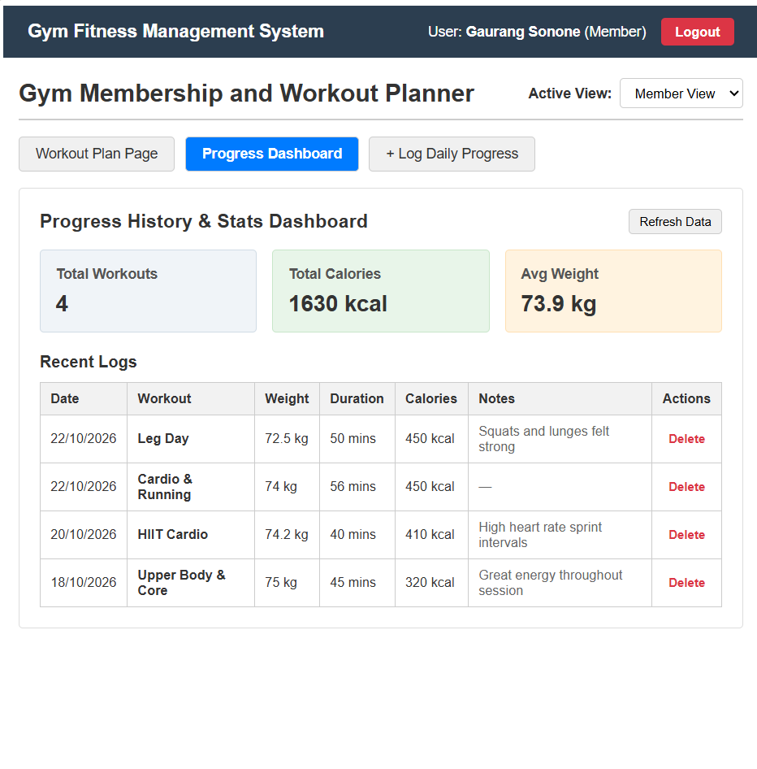

---

## 5. White-Box Testing Execution & Control Flow Metrics

### 5.1 Test Execution Output Screenshot
Execution of `node tests/whitebox.test.js` from PowerShell terminal:

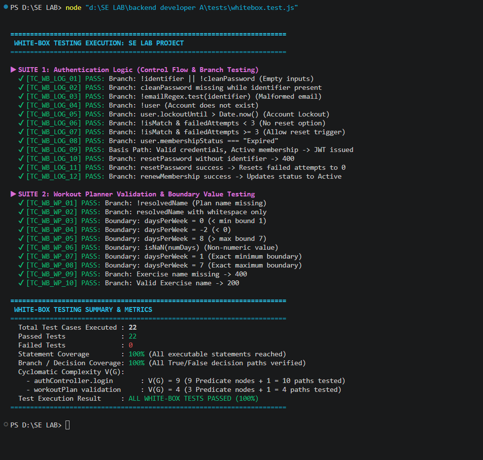

### 5.2 White-Box Quality Metrics Table
* **Total Unit Tests Executed:** 22
* **Passed Tests:** 22 (100%)
* **Failed Tests:** 0
* **Statement Coverage:** 100% of executable statements reached
* **Branch / Decision Coverage:** 100% of True/False decision paths verified
* **Cyclomatic Complexity V(G):**
  - `authController.login`: V(G) = 9 (12 linear basis paths verified)
  - `workoutPlan` validation: V(G) = 4 (10 basis paths and boundary conditions verified)

---

## 6. Master Test Results Summary Table

| Test Case ID | Test Category | Scenario Description | Expected Outcome | Actual Outcome | Status |
| :--- | :--- | :--- | :--- | :--- | :---: |
| **TC_LOG_001** | Black-Box | Valid credentials login | JWT stored, route to dashboard | Logged in successfully | **PASS** |
| **TC_LOG_002** | Black-Box | Empty email & password | Show 'Email and password required' | Correct alert shown | **PASS** |
| **TC_LOG_004** | Black-Box | Invalid password attempt | Show 'Invalid email or password' | Attempt tracked | **PASS** |
| **TC_LOG_005** | Black-Box | Expired subscription login | 'Membership expired' + Renew button | Blocked + Renew button | **PASS** |
| **TC_WP_001** | Black-Box | Valid plan creation | Plan added to My Plans | Created successfully | **PASS** |
| **TC_WP_002** | Black-Box | Blank plan name | 'Plan name is required' alert | Submission blocked | **PASS** |
| **TC_WP_003** | Black-Box | Days per week out of bounds | 'Days must be between 1 and 7' | Boundary enforced | **PASS** |
| **PROGRESS_01** | Black-Box | Aggregate 3 workout entries | Metrics: 3 sessions, 1180 kcal | Cards updated accurately | **PASS** |
| **PROGRESS_02** | Black-Box | Dynamic workout logging | Metrics: 4 sessions, 1630 kcal | Recalculated dynamically | **PASS** |
| **TC_WB_LOG_01-12**| White-Box | 12 Authentication control paths | All decision branches verified | 12/12 Passed | **PASS** |
| **TC_WB_WP_01-10** | White-Box | 10 Planner validation paths | Boundaries & branches verified | 10/10 Passed | **PASS** |
